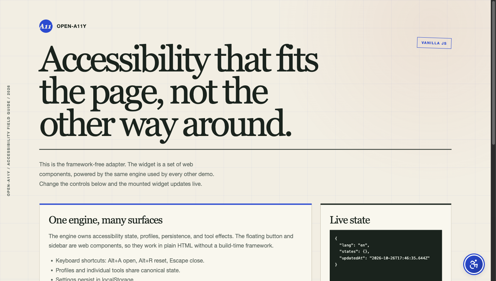

# open-a11y

**One accessible widget, every frontend.** A framework-agnostic accessibility
toolbar with 29 tools, 7 profiles, persistence, keyboard shortcuts, and adapters
for Vanilla JS, React, Vue, Svelte, Angular, Laravel Blade, and Livewire.

[](https://www.npmjs.com/package/@aotr/open-a11y)
[](https://github.com/aotr/open-a11y/actions/workflows/ci.yml)
[](LICENSE)

[Live demos](https://aotr.github.io/open-a11y/) · [Documentation](./docs/README.md) · [Examples](./examples/README.md) ·
[Laravel package](https://github.com/aotr/open-a11y-laravel) ·
[Changelog](./CHANGELOG.md)



---

## Why open-a11y

- **One engine, no duplicate runtimes.** Every adapter consumes the same engine,
  locale table, CSS injector, and widget session registry.
- **Real accessibility controls.** Contrast, text scaling, spacing, readable
  fonts, focus visibility, motion control, reading aids, and keyboard navigation.
- **Canonical state.** Profiles and individual tools write the same vocabulary;
  legacy saved settings are migrated on hydration.
- **Bring your own design.** Position, panel side, offset, blur, button size,
  brand colors, labels, footer, and language are configuration.
- **Small by default.** The core and adapters are minified; adapters import the
  core instead of bundling it again.
- **MIT licensed.** Use it in commercial and open-source projects.

## Adapters

| Runtime                  | Entry                                                                 | Peer dependency      |
| ------------------------ | --------------------------------------------------------------------- | -------------------- |
| Vanilla / Web Components | `@aotr/open-a11y`                                                     | none                 |
| React                    | `@aotr/open-a11y/react`                                               | `react >=17`         |
| Vue                      | `@aotr/open-a11y/vue`                                                 | `vue >=3.5`          |
| Svelte                   | `@aotr/open-a11y/svelte`                                              | `svelte >=5`         |
| Angular                  | `@aotr/open-a11y/angular`                                             | `@angular/core >=17` |
| Laravel Blade + Livewire | [`aotr/open-a11y-laravel`](https://github.com/aotr/open-a11y-laravel) | PHP 8.2+             |

## Install

```bash
npm install @aotr/open-a11y
```

React applications also need React installed. Vue, Svelte, and Angular adapters
are optional peer entries; install the framework you use.

## Quick start

### Vanilla JavaScript

```ts
import {
  AccessibilityEngine,
  localStorageAdapter,
  createAccessibilityUI,
  mergeConfig,
} from "@aotr/open-a11y";

const engine = new AccessibilityEngine({
  storage: localStorageAdapter,
  config: mergeConfig({
    position: "bottom-right",
    brand: { primary: "#1f4bd8", accent: "#b23a25" },
  }),
});

await engine.init();
createAccessibilityUI(engine);
```

The widget is a pair of web components (`<asw-widget>` and `<asw-menu>`), so it
works in any framework or plain HTML.

### React

```tsx
"use client";

import { AccessibilityEngine, localStorageAdapter } from "@aotr/open-a11y";
import { AccessibilityProvider, AccessibilityWidget } from "@aotr/open-a11y/react";

const engine = new AccessibilityEngine({ storage: localStorageAdapter });

export function Root({ children }) {
  return (
    <AccessibilityProvider engine={engine} autoInit>
      <AccessibilityWidget />
      {children}
    </AccessibilityProvider>
  );
}
```

### Vue

```ts
import { createApp } from "vue";
import { AccessibilityEngine, localStorageAdapter } from "@aotr/open-a11y";
import { createAccessibilityPlugin } from "@aotr/open-a11y/vue";

const engine = new AccessibilityEngine({ storage: localStorageAdapter });
const app = createApp(App);

app.use(createAccessibilityPlugin(engine, { showWidgetOnMount: true }));
app.mount("#app");
```

Use `useAccessibility()` inside any component for reactive settings and actions.
`<A11yWidget />` is available for declarative mounting.

### Svelte

```svelte
<script lang="ts">
  import { AccessibilityEngine, localStorageAdapter } from '@aotr/open-a11y'
  import { createAccessibilityStore, accessibilityWidget } from '@aotr/open-a11y/svelte'

  const engine = new AccessibilityEngine({ storage: localStorageAdapter })
  const a11y = createAccessibilityStore(engine)
</script>

<div use:accessibilityWidget={{ engine }}></div>
```

### Angular

```ts
import { bootstrapApplication } from "@angular/platform-browser";
import { provideAccessibility } from "@aotr/open-a11y/angular";
import { AccessibilityEngine, localStorageAdapter } from "@aotr/open-a11y";
import { App } from "./app";

const engine = new AccessibilityEngine({ storage: localStorageAdapter });

await engine.init();
bootstrapApplication(App, {
  providers: [provideAccessibility(engine)],
});
```

```ts
import { Component, afterNextRender, inject } from "@angular/core";
import { AccessibilityService, mountAccessibilityWidget } from "@aotr/open-a11y/angular";

@Component({ selector: "app-root", template: "" })
export class App {
  readonly service = inject(AccessibilityService);

  constructor() {
    afterNextRender(() => mountAccessibilityWidget(this.service, { side: "right" }));
  }
}
```

### Laravel

```bash
composer require aotr/open-a11y-laravel
```

```blade
<x-open-a11y::widget :config="['position' => 'bottom-right']" />
<livewire:open-a11y::widget />
```

The companion package ships the standalone browser bundle, asset publishing, and
reactive Livewire controls. See the
[Laravel README](https://github.com/aotr/open-a11y-laravel).

## Configuration

```ts
import { mergeConfig } from "@aotr/open-a11y";

const config = mergeConfig({
  side: "right",
  position: "bottom-right",
  offset: [20, 20],
  blur: true,
  buttonSize: 56,
  buttonSizeMobile: 44,
  showButton: true,
  defaultLanguage: "en",
  labels: {
    "widget.menuTitle": "Accessibility options",
  },
  brand: {
    name: "Acme",
    url: "https://example.com",
    footerText: "Accessibility tools by Acme",
    primary: "#1f4bd8",
    primaryDark: "#1739a8",
    accent: "#b23a25",
  },
  features: {
    tools: { "dark-contrast": false },
    profiles: { "seizure-safe": true },
    languageChange: true,
  },
});
```

Explicit `createAccessibilityUI(engine, options)` values override the engine
config for that mount. `createAccessibilityUI` accepts `position`, `side`,
`offsetX`, `offsetY`, `blur`, `container`, and `config`.

### Canonical state

Exclusive tools store the active ID under their group key:

```ts
{
  contrast: 'high-contrast',       // or false
  textAlign: 'text-align-center',  // or false
  fontSize: 1.5,
  lineHeight: 1.4,
  letterSpacing: 2,
  'font-weight': true,
  activeProfile: 'vision-impaired',
}
```

Legacy keys such as `'high-contrast': true` are migrated during hydration.

### CSP nonce

```ts
import { setStyleNonce } from "@aotr/open-a11y";

setStyleNonce(document.querySelector<HTMLMetaElement>('meta[name="csp-nonce"]')?.content);
```

Every injected accessibility stylesheet carries the nonce.

## Live demos

Try the hosted demos at **[aotr.github.io/open-a11y](https://aotr.github.io/open-a11y/)**.

Each demo is a standalone app with the same customization panel and state
inspector:

| Adapter          | Command                                                       | URL                   |
| ---------------- | ------------------------------------------------------------- | --------------------- |
| Vanilla          | `npm run demo:vanilla`                                        | http://localhost:4174 |
| React            | `npm run demo:react`                                          | http://localhost:4175 |
| Vue              | `npm run demo:vue`                                            | http://localhost:4176 |
| Svelte           | `npm run demo:svelte`                                         | http://localhost:4177 |
| Angular          | `npm run demo:angular`                                        | http://localhost:4178 |
| Blade + Livewire | see [Laravel repo](https://github.com/aotr/open-a11y-laravel) | http://localhost:4179 |

Run `npm run build:demos` to assemble all apps into `site/`, or `npm run build` once before starting a demo. Each app has its own source and
`package.json`; see [examples/README.md](./examples/README.md).

## Package exports

| Path                         | Contains                                                       |
| ---------------------------- | -------------------------------------------------------------- |
| `@aotr/open-a11y`            | engine, storage, config, tools, profiles, i18n, web components |
| `@aotr/open-a11y/react`      | provider, hooks, widget, inline panel                          |
| `@aotr/open-a11y/vue`        | plugin, composable, widget component                           |
| `@aotr/open-a11y/svelte`     | readable store, widget action                                  |
| `@aotr/open-a11y/angular`    | providers, signal service, mount helper                        |
| `@aotr/open-a11y/styles.css` | optional base stylesheet                                       |
| `@aotr/open-a11y/browser`    | standalone IIFE bundle for script tags                         |

## Development

```bash
npm install
npm run lint        # vp check: format, lint, type-check
npm test            # vp test (Vitest 5)
npm run build       # Rollup runtime bundles + tsc declarations + ng-packagr
npm run build:demos # vp build for every app, assembled into site/
npm run test:dist
```

Development, checks, tests, and demo builds run through
[Vite+](https://viteplus.dev/) (`vp check`, `vp test`, `vp dev`, `vp build`).
The library bundle stays on Rollup because it must emit shared-entry ESM/CJS
adapters plus a standalone IIFE; Angular declarations are built with ng-packagr
so AOT consumers receive provider metadata.

Deep dives live in [`docs/`](./docs/):

- [Engine and state ownership](./docs/engine.md)
- [Configuration](./docs/config-system.md)
- [CSS and CSP](./docs/css-system.md)
- [Profiles](./docs/profiles.md)
- [React adapter](./docs/react-adapter.md)
- [Web components](./docs/web-components.md)
- [Storage](./docs/storage-adapters.md)
- [i18n](./docs/i18n.md)

## Browser support

Modern browsers with Custom Elements, Shadow DOM, CSS custom properties, and ES2020.
That includes Chrome, Edge, Firefox, and Safari from the last two major versions.

## Contributing

Read [CONTRIBUTING.md](./CONTRIBUTING.md). Bug reports and adapter examples are
welcome.

## License

MIT © [Animesh Chakraborty](https://github.com/aotr)
